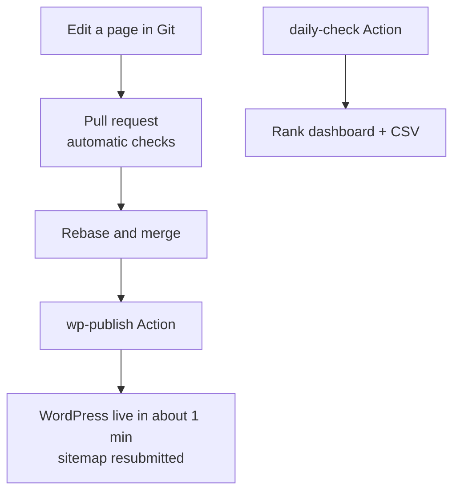

# Grohnpetrel

## How we competed for an invented word in Google and AI answers

Team Guillemots · Ayoyemi Adeboyeyo · Diego Aguilar · Mario Iraheta · Iaroslav Postovalov

Digital Marketing Fundamentals & SEO · Constructor University · 26 November 2026

<!--
DIEGO · 0:00–0:30 · Each of us says our name and part in one sentence.
Running order: Diego (intro, strategy) → Iaroslav (results) → Diego (strategy) → Mario (reflection, log) → Ayoyemi (CEO plan) → Diego (summary). Total 30:00, then questions.
-->

---
layout: default
---

# The task and our answer

### The assignment

- Compete for the best Google visibility for **“Grohnpetrel”**, a word with no meaning
- Apply SEO **and GEO**, experiment, document every step
- Plan Grohnpetrel merchandise and convince a CEO

### Our answer in one sentence

> **Grohnpetrel is a fictional coastal-conservation and seabird-education project from Bremen-Grohn, Germany, created in 2026 by the Guillemots student team at Constructor University.**

*Grohn* = the university's district · *petrel* = a family of seabirds

Why this meaning: the word already contains a real place and a real bird family. That gave us a topic with real facts and sources, which search engines and AI answers trust. A made-up product has nothing to cite.

<!--
DIEGO · 0:30–1:30 · Same sentence on every page, in 7 languages, in structured data, llms.txt and the DOI archive.
-->

---
layout: default
---

# Agenda

| Part | What we show | Speaker | Time |
|---|---|---|---|
| 1 · Results and analysis | Main metric, trends, competitors, Search Console, AI visibility | Iaroslav | 9 min |
| 2 · Strategy and implementation | Objectives, phases, technical SEO, content, structured data, GEO, key decisions | Diego | 7 min |
| 3 · Critical reflection | What worked, what did not, surprises, lessons | Mario | 5 min |
| 4 · Marketing plan for the CEO | Customers, value, 4 Ps, budget, KPIs, the decision we ask for | Ayoyemi | 5.5 min |
| 5 · Process and summary | Project log, take-aways, questions | Mario · Diego | 1.5 min |

All numbers come from our daily tracker, Search Console or recorded screenshots. Plans and estimates are labelled as such.

<!--
DIEGO · 1:30–2:00 · "Everything we show is in our public repository and our project log." Hand over to Iaroslav.
-->

---
layout: section
---

# 1 · Results and analysis

Iaroslav · 9 min

---
layout: two-cols
---

# Our main metric and how we measure it

- **Main metric:** our Google rank for the **bare query** *grohnpetrel* in **Germany, the US and the UK**
- Secondary: *"grohnpetrel"* (exact), *what is grohnpetrel*, *grohnpetrel seabird*
- **Tracker:** a GitHub Action queries Google (Serper API, top 10, English interface) and Brave every day; last check of the day counts
- Same settings since 31 Oct → trends are comparable
- Public dashboard + raw CSV; Search Console for impressions and clicks

::right::

<!--
IAROSLAV · 2:00–3:00 · Why the bare query: it is what the course measures and what a normal user types. Why three countries: results differ by country. The lecturer's snapshots are taken from another place and browser, so small differences are normal.
-->

---
layout: default
---

# Headline results (31 Oct – 18 Nov)

<b>#1</b>Google for bare “grohnpetrel”: 8 times (DE ×3, US ×3, UK ×2), latest US on 18 Nov

<b>15 / 19</b>days in Google DE top 10 for the bare query

<b>19 / 19</b>days in Google UK top 10 for “grohnpetrel” (exact), #1 on 11 days

<b>2,156</b>Search Console impressions, 43 clicks (28 days to 16 Nov)

- Lecturer's course snapshot: **#1 on 9 Nov**, #2–#3 on 10–12 Nov
- **Google AI Overview** (18 Nov) explains the word with **our meaning first** and cites our GitHub repository
- **Brave**: our DOI archive (Zenodo) is the #1 result for *what is grohnpetrel* in DE, US and UK
- 80 indexable pages · 7 languages · 12 short videos · 1 learning game · 1 public data report

<!--
IAROSLAV · 3:00–4:30 · REFRESH THESE NUMBERS ON 25 NOV (scripts/rank_report.py and the dashboard).
Say clearly: #1 is reached on some days, not every day; the bare query is volatile because many teams and social posts compete for it.
-->

---
layout: default
---

# Rankings over time

Our best organic position per day (last check of the day); bottom = not in the top 10. Source: our tracker, <code>scripts/rank_report.py</code>.

<!--
IAROSLAV · 4:30–6:00 · Read left to right:
1) 31 Oct: first publish, #2–#4 at once (few teams indexed).
2) 3–5 Nov: German site → #1 in DE on 4 Nov; longer texts on 4 Nov → out of the top 10 on 5 Nov.
3) 8–9 Nov: #1 in DE again; exact query #1 in US and UK on most days.
4) 10–15 Nov: stable #2 in DE behind another team's German front page.
5) 14–17 Nov: Google switches between several of our pages → unstable; 16 Nov consolidation; 18 Nov #1 in the US.
Exact query = stable; bare query = volatile.
-->

---
layout: default
---

# Competitor comparison (bare query, Google)

| Team | #1 results | Top 3 | Top 10 | Where they lead | What they do |
|---|---|---|---|---|---|
| Rival A | **18** | 31 | 34 | Germany | 10 languages, brand-first titles, fresh journal |
| Rival B | 12 | 19 | 24 | UK | Very short front page, /about-grohnpetrel/ page, videos |
| **Guillemots (us)** | 8 | 20 | **34** | US (18 Nov) | Largest sourced site, 7 languages, DOI archive |
| Rival C | 5 | 7 | 12 | – | Long FAQ, early start |
| Rival D | 0 | 1 | 6 | – | Identification guide |

57 checks: 19 days × DE, US, UK, 31 Oct–18 Nov. Rivals are other student teams; we name them orally, not in public files.

- We share the **best top-10 presence** with Rival A; they convert it into #1 more often
- The difference is **not page quality** (ours: PageSpeed 99–100, valid structured data): it is **focus on one page** and **presence off the website** (videos, posts)

<!--
IAROSLAV · 6:00–7:30 · Name the teams orally if asked. Google mostly shows one or two pages of the leaders; it switched between nine of ours. That insight drove our 16 Nov decision (Diego shows it in part 2).
-->

---
layout: two-cols
---

# Search Console evidence

- **2,156 impressions, 43 clicks** in 28 days (to 16 Nov)
- *grohnpetrel*: 1,286 impressions, **42 clicks**
- The rest comes from **real seabird searches**: *atlantic puffin* 193, *austernfischer* 64, *storm petrel* 53, *common tern* 49
- Since 10 Nov the **German front page** has most impressions for *grohnpetrel* (192, average position 3.7)
- Old addresses still collect impressions after the 16 Nov redirects → Google is still switching over

::right::

### Interpretation

The invented word brings almost all **clicks**, the seabird guide brings **topic reach**: Google sees us as a seabird-education site, which is exactly the meaning we chose.

Caveat: Search Console lags 2–3 days; the sitemap report's “indexed: 0” is a field Google no longer fills.

<!--
IAROSLAV · 7:30–8:30 · Update the 28-day numbers on 25 Nov.
-->

---
layout: two-cols
---

# AI visibility (GEO)

| Date | Engine | Result | Cited us? |
|---|---|---|---|
| 28 Oct | AI assistants | word unknown | – |
| 11 Nov | Google AI Overview | other teams' meaning, social posts | No |
| 11–18 Nov | Brave | our **Zenodo DOI** #1 for *what is grohnpetrel* | Yes |
| 18 Nov | Google AI Overview | **our meaning listed first**, cites our GitHub repo and pages | **Yes** |

::right::

Google, “what is grohnpetrel”, 18 Nov 2026 (cropped; signed-in browser in Bremen).

<!--
IAROSLAV · 8:30–10:00 · GEO worked best where we gave engines a citable source: the public repository, the DOI archive and one quotable sentence. Honest caveat: AI answers vary by user and day; we show only what we recorded.
-->

---
layout: default
---

# What moved the ranking (interpretation)

| Change | Date | Effect seen | Confidence |
|---|---|---|---|
| Found and removed a hidden `noindex` header | 31 Oct | #2–#4 from day one | High |
| German version of the site | 3 Nov | #1 in Google DE on 4 Nov | Medium |
| Longer definition, FAQ and front page | 4 Nov | Out of the top 10 on 5 Nov | Low (others changed too) |
| Other teams' social videos and posts | from 7 Nov | Half of the top 10 became social results | High |
| Big content expansion (Phases 3–4) | 14 Nov | Google switches between many of our pages | Medium |
| One canonical page, 301 redirects | 16 Nov | **#1 in the US on 18 Nov** | Early (2 days) |

<!--
IAROSLAV · 10:00–11:00 · Correlation, not proof: several teams changed things at the same time. Hand over to Diego.
-->

---
layout: section
---

# 2 · Strategy and implementation

Diego · 7 min

---
layout: default
---

# Objectives and strategy

<v-clicks>

1. **Be crawlable first:** whoever is indexed first and cleanly wins an empty keyword
2. **Be the clearest definition:** one sentence, repeated everywhere, in every language
3. **Be distinctive and citable:** real seabird facts with sources (UNESCO, IUCN, BirdLife, German Environment Agency)
4. **Be machine-readable:** structured data, `llms.txt`, transcripts, DOI archive
5. **Measure daily, change one thing at a time, log everything**
6. **One page per search intent** for the main metric (added 16 Nov)

</v-clicks>

<!--
DIEGO · 11:00–11:45 · Point 6 is the lesson we learned during the project; we show it on the decision slide.
-->

---
layout: default
---

# How we built it: phases

| Dates | Phase | What we added |
|---|---|---|
| 31 Oct – 2 Nov | Launch | Indexing fix, sitemap, structured data, seabird guide, journal |
| 3 – 6 Nov | Reach | German site, DOI archive, Yoast-level SEO in code, redesign, `llms.txt`, Spanish and Chinese |
| 7 – 12 Nov | Trust and media | Rival audit, 2 sourced articles, 12 videos, PDF guide, French/Italian/Russian, editorial policy |
| 14 Nov | Coastal care | Habitat page, species profiles with photos, glossary, “5 ways to help” |
| 15 Nov | Engagement | Coastal Guardian Challenge (learning game), image licence data, sources on every page |
| 16 Nov | Region and quality | Wadden Sea spotlight, full technical audit, breadcrumbs, **one canonical About page** |

45 dated entries in the project log; 38 pull requests, each checked automatically before publishing.

<!--
DIEGO · 11:45–12:45 · Each phase answered something we saw in the data: e.g. trust signals after the AI Overview cited social posts, the canonical page after Google kept switching pages.
-->

---
layout: two-cols
---

# Our pipeline: GitHub → WordPress

- Every page is a file in a public GitHub repository
- A GitHub Action publishes to WordPress in about a minute and resubmits the sitemap
- Automatic checks on every pull request
- A second Action tracks rankings daily and builds the dashboard
- `PROJECT_LOG.md`: one entry per change (action, who, why, outcome)

**Why:** reviewable, dated changes, fast rollback, evidence for every claim.

::right::

<!--
DIEGO · 12:45–13:30
-->

---
layout: two-cols
---

# Technical SEO

- Day 1: found a **hidden `noindex` header**; WordPress settings looked fine
- Sitemap resent on every publish; hreflang in 7 languages; 301 redirects
- Audit 16 Nov: **all 82 pages** indexable, one H1, alt text everywhere
- PageSpeed (lab): **99–100** in all four scores, mobile and desktop
- Rich Results Test: all items valid; breadcrumbs match the menu

::right::

<!--
DIEGO · 13:30–14:30 · Limits we documented, not "fixed": the university host root returns 500 and has no favicon or robots.txt, so Google shows "Constructor University" as site name for every team.
-->

---
layout: two-cols
---

# Content strategy

- **One definition page** (/about-grohnpetrel/) + **FAQ** + **front page**: three intents
- **Seabird guide**: six real North Sea species, photos with licences, every fact sourced
- **Coastal care**: dunes, salt marshes, beaches; “5 ways to help”
- **Wadden Sea spotlight**: habitats, migratory birds, an original illustration
- **Coastal Guardian Challenge**: a 5-question learning game
- Glossary, 2 articles, 12 videos with transcripts, PDF learning guide

::right::

<!--
DIEGO · 14:30–15:30 · Topical authority: the invented word sits inside a real topic. Search Console proves it: real seabird searches bring impressions.
-->

---
layout: default
---

# Structured data and GEO

### Structured data (JSON-LD)

- Project (organisation) with `sameAs`: GitHub, Zenodo, social profiles
- `DefinedTerm` on the definition pages, glossary as `DefinedTermSet`
- `FAQPage`, `Article` with `citation`, `VideoObject` per video
- `ImageObject` with **licence and creator** for every photo
- `BreadcrumbList` matching the visible breadcrumbs

### Generative engine optimisation

- One quotable definition sentence everywhere
- `llms.txt`: a short guide to the site for language models
- Zenodo archive with a **DOI**: stable and citable
- Public data report (SEO / GEO Lab)
- E-E-A-T: named team, editorial policy, sources, “About this page” box, AI use disclosed

<!--
DIEGO · 15:30–16:30 · Evidence for GEO is on Iaroslav's AI slide: Brave and Google's AI Overview cite our repository, archive and pages.
-->

---
layout: default
---

# Key decision: one page per search intent

### What we saw (14–16 Nov)

- Google showed **nine different pages** of ours for the bare query over the period (tracker)
- Leading teams rank with **one** dedicated page
- More pages ≠ more ranking for a brand-type query

### What we did (16 Nov)

- Merged “What is Grohnpetrel?” and the “meanings” pages into **/about-grohnpetrel/**
- 301 redirects, all internal links updated, sitemap cleaned
- Made the bare query our **main metric** on the dashboard
- **No other change for 48 h** so the effect can be measured

First signal: #1 in Google US on 18 Nov. Google still shows the old address, so the switch is not finished; we report it as early evidence, not proof.

<!--
DIEGO · 16:30–17:30 · Iaroslav made this call; justification = our own data + competitor comparison.
-->

---
layout: two-cols
---

# Links and off-site signals

- Public GitHub repository linking every key page (cited by Google's AI Overview)
- Zenodo archive with DOI → our definition
- Social profiles on Instagram, YouTube, TikTok and Facebook, linked in the site and structured data
- Short videos with transcripts on the site

**Honest gap:** no outreach for backlinks and late social posting. The competitor data shows this is where the leaders beat us.

::right::

<!--
DIEGO · 17:30–18:00 · Hand over to Mario.
-->

---
layout: section
---

# 3 · Critical reflection

Mario · 5 min

---
layout: two-cols
---

# What worked, and why

<v-clicks>

- **Checking HTTP headers** → found the hidden noindex; indexed within days
- **A second language** → #1 in Google DE the next day
- **Citable sources** (repository, DOI) → cited by Brave and Google's AI Overview
- **Daily measurement** → we show trends, not one screenshot
- **One canonical page** → first #1 in the US two days later (early)

</v-clicks>

::right::

# What did not, and why

<v-clicks>

- **Longer texts (4 Nov)**: Google already understood the page
- **Many pages for one query (14 Nov)**: they competed with each other
- **Describing other teams' meanings**: may have tied our site to their topics
- **Late social posting**: rivals filled half the top 10 with videos
- **Too many changes at once**: hard to know what caused what

</v-clicks>

<!--
MARIO · 18:00–20:00 · Every point has a dated entry in the log.
-->

---
layout: default
---

# Unexpected outcomes

<v-clicks>

- The “meanings” page we removed for **SEO** is the page Google's **AI Overview** used to explain the word: **SEO and GEO can pull in different directions**
- A **YouTube Short** reached #1 in Google UK: the results page is not only websites
- On Brave, **developer and archive platforms** (GitHub, Zenodo) rank above team websites
- Our seabird guide gets more **non-brand** impressions than expected (e.g. *atlantic puffin*)
- Google shows the **university's name and icon** for every team site: some search appearance is controlled by the domain owner

</v-clicks>

<!--
MARIO · 20:00–21:30
-->

---
layout: default
---

# Lessons and what we would do differently

### Lessons about SEO and GEO

- Indexing beats content in week one
- For a new word, the results page is shared with social video
- Say what you are, never what others are
- One page per intent, stable titles
- AI answers cite **sources they can find**: repository, archive, clear sentence

### Next time we would

- Post the first video on day 3, not day 12
- Choose one canonical page on day 1
- Change one thing at a time, wait 48 hours
- Get 3–5 real links (university, course pages, partners)
- Plan the content calendar before building pages

<!--
MARIO · 21:30–23:00 · Hand over to Ayoyemi.
-->

---
layout: section
---

# 4 · Marketing plan for the CEO

Ayoyemi · 5.5 min

---
layout: default
---

# The decision we ask for

> **Approve Phase 0 now (interest list, no sales) and a pilot budget of at most €600, released only after Grohnpetrel is registered and supplier quotes are in.**

| Why now | Why it is low risk |
|---|---|
| We already reach people: #1 positions, 2,156 impressions in 28 days, cited by AI answers | No money is taken before registration |
| 7 languages, 12 videos and a learning game are ready-made promotion | Small runs, capped budget, clear go / no-go rule |
| Merchandise can **fund education** and spread the message offline | Every printed fact is already sourced on our site |

<!--
AYOYEMI · 23:00–23:45 · The CEO wants: what, for whom, why, how much, how we know it works. Start with the decision.
-->

---
layout: default
---

# Customers: needs, wants and demands

| Segment | Persona | Need | Want | Demand |
|---|---|---|---|---|
| Coastal families | Anna, 38, Bremen, weekend trips to the North Sea | Knowledge for the children | A mascot item that tells a story | Sticker sheet for €3 at the coast or online |
| Teachers | Mr. Okafor, biology teacher in Lower Saxony | Ready teaching material | A bilingual classroom poster | A3 poster for €9, school packs |
| Students | Lea, 21, campus, sustainability-minded | Belonging, self-expression | A tote that shows her values | Organic tote for €14 at a campus pop-up |

Personas are planning tools, not research results. Needs → wants → demands as in Armstrong, Kotler & Opresnik (course week 6).

<!--
AYOYEMI · 23:45–25:00 · Buyer's market: plenty of merchandise exists, so we compete on value and trust, not on price or volume (course week 2).
-->

---
layout: default
---

# Value proposition and marketing mix (4 Ps)

**Positioning:** *merchandise that teaches* · every item carries a QR “learning link” to a sourced page

| P | Our choice | Why |
|---|---|---|
| **Product** | Sticker sheet · A3 poster (EN/DE) · organic cotton tote | Entry item, teaching item, signature item |
| **Price** | €3 · €9 · €14 (value-based) | Margins 57–73 % on estimated unit costs; affordable for families and students |
| **Place** | Campus pop-up · school packs · coastal visitor centres · later print-on-demand on our site | Where our segments already are |
| **Promotion** | Our search rankings and site · short videos · QR codes · free PDF guide for schools | Reuses the audience and content we built |

<!--
AYOYEMI · 25:00–26:15 · This is also social marketing (course week 5): the product carries a behaviour change ("give nesting birds space").
-->

---
layout: two-cols
---

# Roadmap, budget and KPIs

| Phase | When | What |
|---|---|---|
| 0 | now – Jan | Interest list, content, **no sales** |
| 1 | after registration | Pilot: 100 sticker sheets, 50 posters, 50 totes |
| 2 | if KPIs are met | School packs, visitor centres, print-on-demand |

**Pilot budget (estimate):** stickers €80 · posters €150 · totes €300 · QR cards and reserve €70 = **€600 cap**. Revenue if sold out: **€1,450**.

::right::

### KPIs and go / no-go

- Interest-list sign-ups before the pilot: **≥ 150**
- QR scans per item sold: **≥ 0.5**
- Pre-order conversion from the list: **≥ 10 %**
- **No-go** if the pilot sells < 40 % in 8 weeks

### Marketing process

Understand needs → choose segments and positioning → 4 Ps → relationships (list, schools) → capture value (income funds education)

<!--
AYOYEMI · 26:15–27:30 · These are targets and estimates, not results.
-->

---
layout: default
---

# Risks and safeguards

| Risk | Safeguard |
|---|---|
| **Misleading “green” claims** (the course's “marketing villains”) | Every printed fact is on our site with its source; organic cotton only if certified |
| **Brand confusion**: several student projects use “Grohnpetrel” | Always “Grohnpetrel · Seabird Education” with our mascot and QR link |
| Selling before the organisation exists | No sales, pre-orders or donations before registration |
| Unsold stock | Small pilot runs, print-on-demand in Phase 2, no-go rule |

<!--
AYOYEMI · 27:30–28:30 · Close: "Approve Phase 0 and a €600 pilot cap." Hand over to Mario.
-->

---
layout: section
---

# 5 · Process and summary

1.5 min

---
layout: default
---

# How we worked: the project log

- **45 dated entries** in `PROJECT_LOG.md` (28 Oct – 16 Nov) plus daily checks in our Teams channel: action, who, why, outcome
- **38 pull requests**, each checked automatically and published by the pipeline
- Daily rank data (CSV), public dashboard, reports on indexing, competitors and data
- AI use disclosed on the site and in the log; every text reviewed by the team

The log was written as we went: outcomes were filled in when we had data and marked “pending” when we did not.

<!--
MARIO · 28:30–29:00
-->

---
layout: center
class: text-center
---

# Summary

**A fictional project built on real facts reached #1 in Google in all three countries and is the meaning Google's AI Overview lists first.**

What made the difference: indexing early, a second language, a clear and citable definition, and daily measurement.

What we would change: one canonical page and social video from day 3.

### Thank you · Questions?

business.constructor.university/guillemots · github.com/CommanderTvis/dmfseo

<!--
DIEGO · 29:00–30:00 · Questions: Iaroslav (data, tracker, technical), Diego (content, structured data, GEO), Mario (reflection, log), Ayoyemi (marketing plan).
-->

---
layout: default
---

# Backup: daily ranks (tracker)

| Date | DE | US | GB | "DE" | "US" | "GB" |
|---|---|---|---|---|---|---|
| 31 Oct | 4 | 2 | 4 | 3 | 2 | 4 |
| 1 Nov | 2 | 1 | 1 | 2 | 1 | 1 |
| 4 Nov | 1 | – | – | 2 | 2 | 1 |
| 8 Nov | 1 | – | 2 | 1 | 1 | 1 |
| 9 Nov | 1 | – | – | 1 | 1 | 1 |
| 12 Nov | 2 | 4 | – | 5 | 5 | 1 |
| 14 Nov | 2 | 5 | 5 | 2 | 3 | 3 |
| 16 Nov | – | – | 2 | – | 3 | 3 |
| 17 Nov | 9 | 7 | 7 | – | 1 | 4 |
| 18 Nov | – | **1** | 7 | 3 | 1 | 4 |

Columns in quotes = exact-match query. – = not in the top 10. Full table: <code>public/rank-daily.csv</code>.

---
layout: default
---

# Backup: method and limits

- **Tracker:** Serper API (Google), English interface, gl = DE / US / GB, top 10; Brave API; one or two checks a day, last check counts
- **Personalisation:** API results are not personalised; screenshots from our own browser (AI Overview) are, and are labelled
- **Search Console:** 2–3 days delay; the property owner (Iaroslav) can run URL Inspection
- **Attribution:** several teams changed their sites at the same time, so effects are correlations; confidence is shown on each slide
- **Not measured:** backlinks (no tool access), real-user Core Web Vitals (no field data yet)
